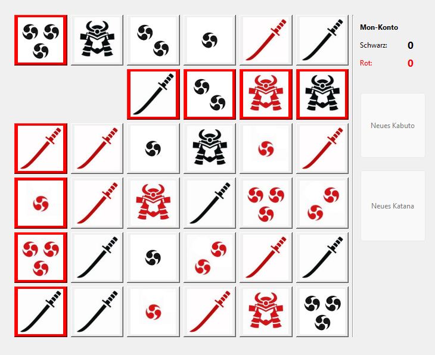

# Kaito-Agent
Developing an intelligent player for the chess-like board game Kaito



## Getting Started

```
pip install -r requirements.txt
python -m kaito                                                      # play red against MatrixSearchPlayer (black)
python -m kaito.simulate --games 10 --red random --black alphabeta   # headless computer matches
python -m pytest                                                     # rule tests
```

## Development Steps

1. Create a game field with the rules implemented
2. Create a user interface for 2 players
3. Enable the development of an intelligent agent by implementing a random player first
4. Evaluate the game state by the remaining pieces (an earlier neural-network evaluator trained by self-play was replaced by hand-written heuristics)
5. Implement depth search with alpha-beta pruning for the best move
6. Add a faster matrix-based search player
7. Evaluate the intelligent players

## Kaito Rules

There are 2 opponent players, red and black, and every tile is visible at all times. Red and black move the same game stone in an alternating manner, either horizontally or vertically. A tile is put out of game as soon as the game stone lands on it.

A player wins the game by removing all opponent Katanas (7 swords) or all Kabutos (3 Helmets) from the playing field. Players can also buy back a Kabuto or Katana at the cost of "Mon", which is collected by removing a tile with the Mon symbol, either 1, 2 or 3, either black or red. 

A player can also win, if he puts the other player in a position with no legal move available.

## Computer Players

Both search players use minimax with alpha-beta pruning. A finished game scores `±(1000 − depth)`, so faster wins and slower losses are preferred. They differ in how they represent the board and how they evaluate positions at the search horizon.

**AlphaBetaPlayer** (`kaito/players/alpha_beta_player.py`) searches copies of the full `GameState`, so Mon collection is part of the search (default depth 6). At the leaves it uses `material_evaluation` from `kaito/evaluation.py`, which looks only at the remaining Katanas and Kabutos of both players:

```
score = −1/own_katanas + 1/opponent_katanas − 1/own_kabutos + 1/opponent_kabutos
```

Because the counts appear as reciprocals, the score is nonlinear: losing one of 7 Katanas barely matters, while losing the last Kabutos costs much more. Mon tiles and the Mon balance are ignored.

**MatrixSearchPlayer** (`kaito/players/matrix_player.py`) builds a compact 36×36 integer matrix every turn. Off-diagonal entries mark which cells the stone can move between, and the diagonal holds each cell's signed piece weight (Mon 1–3 = 1–3, Katana = 4, Kabuto = 5; positive for black, negative for red). A capture just zeroes a column, which makes copies cheap and allows a deeper search (default depth 7). At the leaves it scores the **linear material sum** (the trace of the matrix, i.e. the sum of all remaining piece weights) from its own point of view. This counts every piece type, Mon tiles included, but it doesn't model the Mon balance or buying pieces back.

## Results

With alpha-beta search, the computer player beat a human for the first time. Since then the search has been reworked: game endings are now detected inside the search, and losses are scored as well as wins. These new versions still need to be evaluated, for example with `python -m kaito.simulate`.